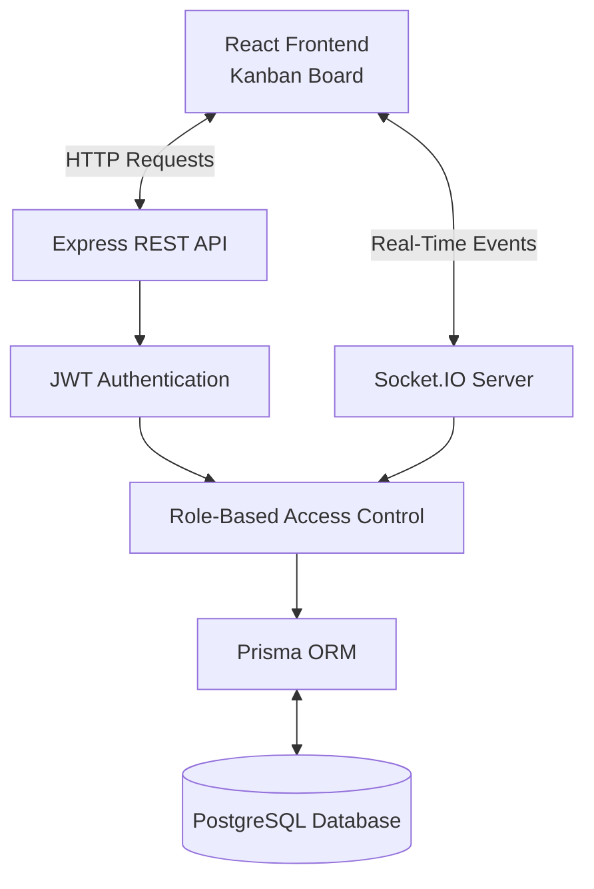

**WebSocket Documentation — Collaborative Kanban Board**

The application uses Socket.IO to provide real-time collaboration between users working on the same Kanban board.

**Connection and Authentication**

Socket.IO runs on the backend server at `http://localhost:5000`.

Each client must provide a valid JWT during connection.

```javascript
const socket = io("http://localhost:5000", {
  auth: {
    token: "YOUR_JWT_TOKEN"
# System Architecture



  }
});
```

Connections without a valid JWT are rejected.

**Socket Events**

| Event | Direction | Description |
|---|---|---|
| `board:join` | Client → Server | Join an authorized board |
| `board:leave` | Client → Server | Leave the current board |
| `board:changed` | Server → Client | Notify users when board data changes |
| `board:presence` | Server → Client | Update online user counts |

**Joining a Board**

Clients join a board by sending its tenant ID and board ID.

```javascript
socket.emit(
  "board:join",
  {
    tenantId: "TENANT_ID",
    boardId: "BOARD_ID"
  },
  (response) => {
    console.log(response);
  }
);
```

Before allowing access, the backend verifies the user's authentication, tenant membership, and board ownership.

**Real-Time Board Updates**

When a task is created, updated, or moved, the server broadcasts a `board:changed` event to users connected to that board.

Example event:

```json
{
  "tenantId": "TENANT_ID",
  "boardId": "BOARD_ID",
  "action": "updated",
  "taskId": "TASK_ID",
  "timestamp": "2026-11-04T10:00:00.000Z"
}
```

The frontend receives the event and reloads the latest board data through the API.

**Online Presence**

The server sends a `board:presence` event containing the number of active connections and unique users.

```json
{
  "onlineUsers": 2,
  "uniqueUsers": 2
}
```

Presence is updated when users join, leave, or disconnect from a board.

**Multi-Tenant Security**

Each board uses a separate Socket.IO room:

`tenant:{tenantId}:board:{boardId}`

This prevents updates from one board being broadcast to another board.

Users must have the required tenant membership before joining a room.

**Security Testing**

Socket.IO security was tested using `backend/scripts/testSocketSecurity.js`.

The tests covered JWT validation, authorized board access, unauthorized tenant access, and board/tenant mismatch protection.

**Result: 7 tests passed, 0 failed.**

**Conclusion**

Socket.IO enables real-time board synchronization while keeping communication restricted to authorized users and tenant-specific boards.